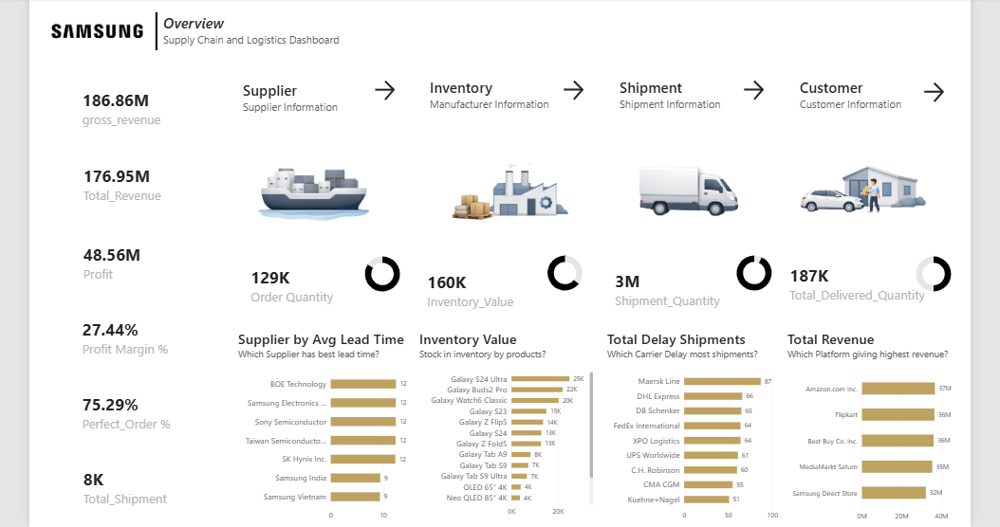

# Supply Chain Control Tower Dashboard | Power BI

An end-to-end Power BI dashboard that tracks the full supply chain flow (supplier, inventory, shipment, and customer) in one view. This is a portfolio project inspired by Samsung's global supply chain.

## Business Questions
- Which supplier has the best lead time?
- Which carriers delay the most shipments?
- Which products hold the most inventory value?
- Which sales platform drives the highest revenue?

## Key KPIs (built with DAX)
| KPI | Value |
|---|---|
| Total Revenue | $176.95M |
| Profit | $48.56M |
| Profit Margin | 27.44% |
| Perfect Order Rate | 75.29% |

Other measures: Order Quantity, Inventory Value, Shipment Quantity, Delivered Quantity, Delayed Shipments, Defect Rate, Safety Stock.

## Tools & Skills
- Power BI Desktop
- DAX
- Data Modeling (fact tables and relationships)
- KPI and Dashboard Design

## Files
- `Supply_Chain_Dashboard.pbix`: the Power BI file
- `dashboard.png`: dashboard screenshot
- `Supply_Chain_Dashboard.pdf`: PDF export

## Author
**Sondos Abu Tenah**
[LinkedIn](www.linkedin.com/in/sondosabutenah)
